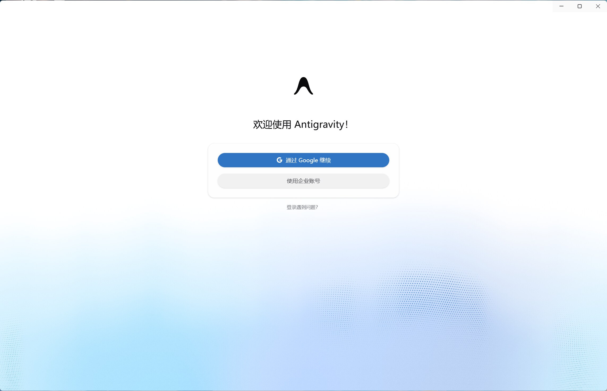
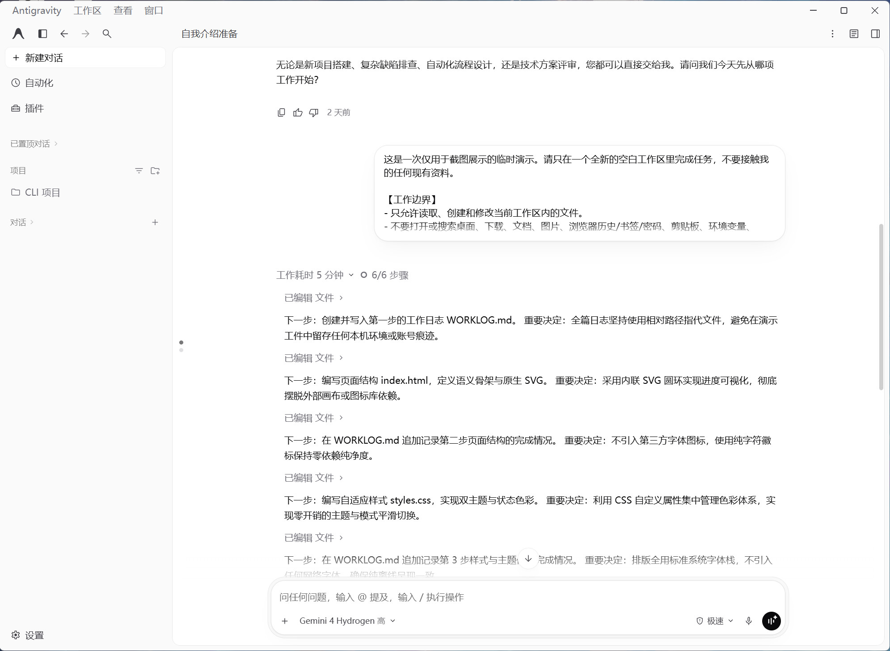
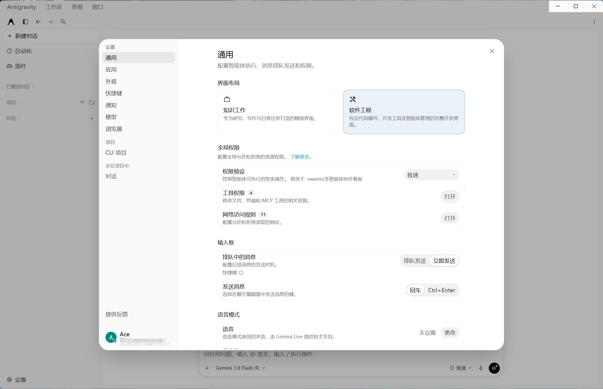

# Antigravity Desktop Chinese Localization (zh-CN Language Pack)

[](https://github.com/Ace2025001/antigravity-desktop-zhcn/releases/latest)
[](https://github.com/Ace2025001/antigravity-desktop-zhcn/releases)
[](#supported-platforms)
[](LICENSE)

A **Simplified Chinese (zh-CN) language pack / Chinese patch** for the **Google Antigravity Desktop** client. Works on Windows x64 and Apple Silicon Macs, runs straight from the extracted folder, re-localizes right after you click “Restart to update” in the client, and restores English anytime.

[中文说明](README.md) · [Setup guides (Chinese)](https://ace2025001.github.io/antigravity-desktop-zhcn/) · [Guide for AI agents](docs/ai-install.md)

| Sign-in | Agent run | Settings |
|---|---|---|
|  |  |  |

## Download and use

1. Download [**Antigravity-Windows+Mac.zip**](https://github.com/Ace2025001/antigravity-desktop-zhcn/releases/latest/download/Antigravity-Windows%2BMac.zip) and extract it. Do not run it from inside the ZIP.
2. Open `win启动` (Windows) or `mac启动` (macOS).
3. Run **`启动中文`** (Start Chinese). Use **`恢复英文`** to restore English and **`汉化设置`** to change settings.

```text
antigravity汉化包/
├─ win启动/     Windows entry points: 启动中文.bat, 恢复英文.bat, 汉化设置.bat
├─ mac启动/     macOS entry points (.command), same usage
└─ 语言包/      translation data and shared code — keep it
```

## First-run settings

The first run asks two questions; press Enter to accept the recommended values. Change them later with `汉化设置`.

| Setting | Options | Recommended |
|---|---|---|
| After the client updates (Windows) | Localize automatically / Ask me / Do nothing | Localize automatically |
| Online fill-in translation | On / Off | On |

- **Localize automatically**: after “Restart to update”, the new version is localized and reopened in Chinese in about 40 seconds. **Ask me** shows a Yes/No prompt. No scheduled task or resident process is installed.
- **Online fill-in**: UI strings not yet in the dictionary, plus conversation titles, are translated with Google Translate. Chat content, code, terminal output, file names, links, paths and anything you type are never sent.

## Features

- **Ready to run**: bundled runtime, no Node.js needed; finds the client automatically.
- **Thorough**: 16,000+ curated translations: menus, tray, settings, agent execution traces and tool calls (file edits, shell commands with exit codes, MCP tools, image generation), the plugin marketplace (75+ plugins), quotas and input shortcuts. Names such as `agy` CLI, Catppuccin and Dracula are kept.
- **Reversible**: conversation data is never modified; on Mac the official app stays untouched.
- **Leaves your system alone**: no proxy, network or system setting changes, no background services.

## Supported platforms

| Item | Notes |
|---|---|
| Windows x64 | Tested on Antigravity Desktop 2.32.2, 2.33.0, 2.34.0 and 2.35.1; follows client updates automatically |
| Apple Silicon macOS | Keeps the official app and builds a locally signed Chinese copy; Intel Macs not verified |
| Scope | Antigravity Desktop client only — **not** the Antigravity IDE extension |
| Compatibility | The client's file structure is checked before every run; new versions are adapted automatically when possible, otherwise it stops with a message instead of forcing changes |

## FAQ

- **Restore English?** Save your work and run `恢复英文`; the official English client is restored and conversations are untouched.
- **Full pack, language update or Source code?** First-time users need the full pack only. The language update is for existing users; Source code is for developers.
- **Updating translations?** Download the latest release, replace the `语言包` folder and run `启动中文` again.
- **Install with an AI agent?** Ask Claude Code, Codex, Cursor or another agent to follow [docs/ai-install.md](docs/ai-install.md).

## Development

Requires Node.js >= 22.12.0. Run `npm ci --ignore-scripts`, `npm test` and `npm run validate`. See [architecture](docs/architecture.md), [releasing](docs/releasing.md), [contributing](CONTRIBUTING.md) and [AGENTS.md](AGENTS.md).

MIT licensed.
