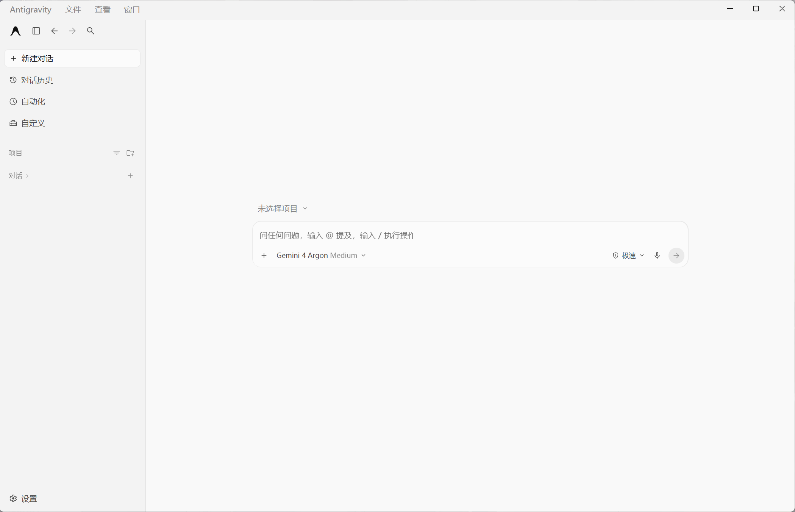

# Windows and macOS support

This project now includes Apple Silicon macOS support alongside Windows x64. See [Mac setup instructions](macOS/README.md). Run check, open the official app and capture its UI, quit it, then install the localized copy. The official app remains unchanged. Intel Macs are not verified. The contributor tested Desktop 2.29.0 on macOS 27.0.1 arm64; the merged build still needs on-device verification. Mac portable releases use `antigravity-desktop-zhcn-portable-macos-arm64.zip`.

The Windows instructions below remain applicable to Windows only.

# Antigravity Desktop Chinese Language Pack for Windows

[简体中文](README.md) · English

A community-maintained Simplified Chinese localization patch for the standalone **Google Antigravity Desktop** app on **Windows x64**. The portable ZIP includes Node.js and dependencies, so users do not need to set up a development environment. Supports the latest client through dynamic adaptation, without choosing a separate package for every client version. Provides compatibility checks, installation, desktop shortcuts and restoration to English.

This project is not affiliated with Google. It targets the standalone Desktop client; an IDE language-pack extension is a different solution.

[**Download the Windows portable ZIP**](https://github.com/Ace2025001/antigravity-desktop-zhcn/releases/latest/download/antigravity-desktop-zhcn-portable-win-x64.zip) · [Release notes and SHA-256](https://github.com/Ace2025001/antigravity-desktop-zhcn/releases/latest)

## Install

1. Download `antigravity-desktop-zhcn-portable-win-x64.zip` and its `.sha256` file from the latest release. Verify the ZIP hash. GitHub's Source code archives do not include the bundled runtime.
2. Extract the entire ZIP to a local folder.
3. Run `Windows/一键检查兼容性.bat` and read the version, fingerprint and runtime-check results.
4. Save your work. Run `Windows/一键汉化.bat` and follow its prompts, or use `Windows/启动 Antigravity（自动汉化）.bat` for dynamic adaptation. The batch installer may fall back to adaptation after an error; agents should distinguish an unregistered build from other errors.
5. Reopen Antigravity Desktop and verify the Chinese interface.

Optional: run `Windows/生成桌面快捷方式.bat` to create a desktop launch shortcut.

## Restore English

Save your work, run `Windows/一键恢复英文.bat`, follow its prompts, then reopen the client. Keep the original backups and installation state until restoration has been verified.

## AI-assisted installation

For assistants authorized by the user to install this project, read the [agent installation guide](docs/ai-install.md). In the extracted portable root, the direct commands are:

```powershell
& '.\runtime\node.exe' '.\src\cli.mjs' check
# Install only after reviewing a suitable compatibility result:
& '.\runtime\node.exe' '.\src\cli.mjs' install
# Restore when needed:
& '.\runtime\node.exe' '.\src\cli.mjs' restore
```

The installer may launch the client to read its runtime UI, then ask the user to close it and press Enter. A zero exit code alone is not proof of successful localization: cancellation can also return zero. This is not guaranteed unattended installation. Preserve the user's proxy, VPN/TUN configuration, work and backups.

## Compatibility

See [version records and verification scope](docs/compatibility.md). Version numbers alone are insufficient: build fingerprints and runtime resources matter. Adaptive structural checks are distinct from real-device verification. Known build records are not the support ceiling. Use the adaptive entry for unregistered builds or client updates; structural validation must pass.

## Screenshot and documentation



- [Architecture](docs/architecture.md)
- [Maintenance](docs/maintenance.md)
- [Build and release](docs/releasing.md)
- [Contributing](CONTRIBUTING.md)
- [Report an issue](https://github.com/Ace2025001/antigravity-desktop-zhcn/issues)

## Credits and license

Continued development based on [chenmo00000/antigravity-desktop-zhcn](https://github.com/chenmo00000/antigravity-desktop-zhcn). Licensed under [MIT](LICENSE).
