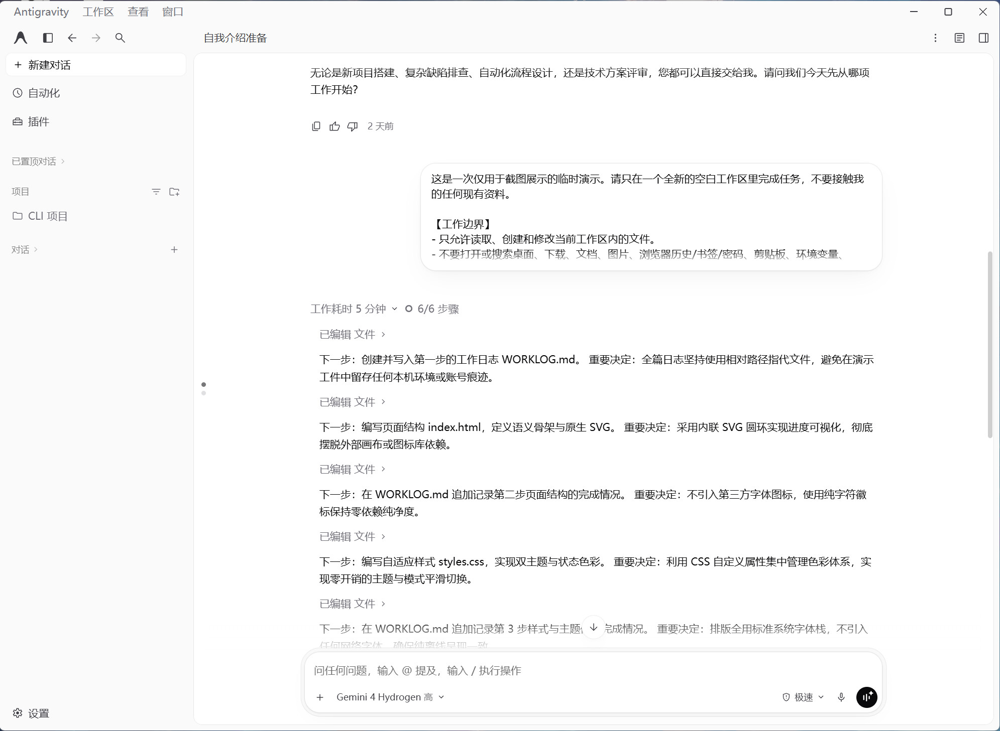
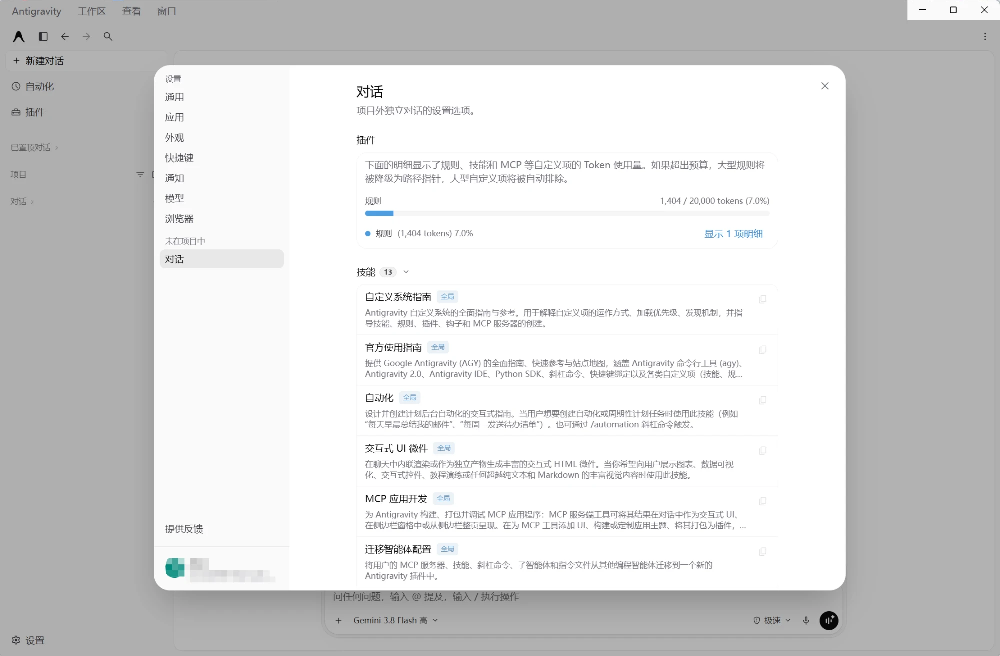

# Antigravity Desktop 汉化包（反重力中文）｜Windows / Mac 简体中文语言包

[](https://github.com/Ace2025001/antigravity-desktop-zhcn/releases/latest)
[](https://github.com/Ace2025001/antigravity-desktop-zhcn/releases)
[](#支持哪些系统和版本)
[](LICENSE)
[](#支持范围)

Google Antigravity（反重力）Desktop 桌面客户端的开源简体中文汉化包（Antigravity 中文语言包）。Windows 和 Apple 芯片 Mac 通用，解压即用，在客户端里点更新后自动跟着重新汉化，随时可以一键恢复英文。

[安装教程](https://ace2025001.github.io/antigravity-desktop-zhcn/) · [常见问题](https://ace2025001.github.io/antigravity-desktop-zhcn/faq/) · [更新日志](https://ace2025001.github.io/antigravity-desktop-zhcn/changelog/) · [AI 助手安装指南](docs/ai-install.md) · [English](README.en.md)

| 登录页 | 智能体执行过程 | 设置 |
|---|---|---|
|  |  |  |

## 下载与使用

### [⬇ 下载完整汉化包（Windows + Mac）](https://github.com/Ace2025001/antigravity-desktop-zhcn/releases/latest/download/Antigravity-Windows%2BMac.zip)

> 觉得好用的话，请点右上角 ⭐ **Star**。星越多，越容易被搜到，也能让更多人用上中文版。

1. 下载后右键“全部解压缩”，不要在压缩包里直接运行。
2. Windows 打开 `win启动`，Mac 打开 `mac启动`。
3. 双击 **启动中文**，按提示完成。第一次运行会问两个设置，直接回车用推荐值即可。

想换回英文，双击 **恢复英文**；想改设置，双击 **汉化设置**。

> 发布页上的文件名是 `Antigravity-完整汉化包-Windows+Mac.zip`，下载后显示为 `Antigravity-Windows+Mac.zip`，是同一个文件。不需要下载 Source code。

解压后的目录如下，你只需要用到各自系统文件夹里的三个入口：

```text
antigravity汉化包/
├─ win启动/            ← Windows 用这里
│  ├─ 启动中文.bat      汉化并打开客户端（日常也可以用它打开）
│  ├─ 恢复英文.bat      还原官方英文原版
│  ├─ 汉化设置.bat      修改下面两项设置
│  └─ 配套程序/         内置运行环境，不要删除
├─ mac启动/            ← Mac 用这里（.command 文件，用法相同）
└─ 语言包/             翻译词库和共用程序，不要删除
```

## 首次使用的设置

第一次运行“启动中文”时会在窗口里问两个问题，直接回车就是推荐值。以后随时双击 **汉化设置** 修改。

| 设置 | 选项 | 推荐 |
|---|---|---|
| 客户端更新后怎么处理（Windows） | 自动汉化 / 先问我 / 不处理 | 自动汉化 |
| 联网补充翻译 | 开启 / 关闭 | 开启 |

### 客户端更新后会发生什么

在客户端里点“重启以更新”后，按你的设置处理：

- **自动汉化**：等新版本装好，自动关掉重启出来的英文窗口，重新汉化并打开中文版，过程中有进度窗口，大约 40 秒。
- **先问我**：弹窗问你“是否现在一键汉化”。选“是”打开汉化窗口；选“否”则这个版本不再提醒。
- **不处理**：保持英文，需要时双击“启动中文”。

汉化包没有计划任务，也不常驻后台，只在客户端退出时检查一次是否发生了更新。Mac 暂不支持自动跟随，用桌面上的“Antigravity自动汉化”打开客户端即可，它会先检查并在需要时重新汉化。

### 联网补充翻译

汉化包内置 1.6 万条人工整理的译文。客户端新版本难免出现还没收录的英文，开启这项后会通过谷歌翻译补齐，结果只保存在你的电脑上。

- **会发送**：界面上还没收录的英文，以及对话标题。
- **不会发送**：对话内容、代码、终端输出、文件名、链接、路径，以及你输入的任何内容。
- 关闭后完全不联网。改完重新打开客户端即可生效，不需要重新汉化。

## 主要特点

- **解压即用**：内置运行环境，无需安装 Node.js；自动找到客户端，找不到时弹窗选择。
- **更新后自动汉化**：在客户端里点“重启以更新”后，自动跟着重新汉化；也可以设为先问你。
- **翻译全面**：1.6 万条人工整理的译文，用语统一，告别中英混杂。
- **联网补充翻译**：新版本里还没收录的英文用谷歌翻译补齐，可随时关闭。
- **安全可恢复**：不修改对话记录，一键恢复英文；Mac 保留官方原版，另建中文副本。
- **不碰你的环境**：不修改代理、节点、系统设置，不安装任何后台服务。

## 汉化了哪些内容

| 首页 | 设置：技能与 Token 用量 |
|---|---|
|  |  |

- **基础界面**：主菜单、系统托盘、全局设置、独立对话面板、权限确认弹窗。
- **智能体（Agent）执行过程**：文件创建 / 编辑 / 删除、运行命令与退出代码、MCP 工具调用、图片生成、网页读取、思考中 / 工作中 / 探索中等状态，命令和路径原样保留。
- **插件市场**：官方与合作伙伴的 75+ 插件、子选项、推荐提示词和授权说明。
- **其他细节**：首页问候语、模型用量与配额说明、对话时间线卡片、输入框快捷键提示。
- **保留专有名词**：`agy` CLI、Catppuccin、Dracula、One Dark Pro、Tokyo Night 等不翻译。
- **绝不翻译**：你输入的内容、对话内容、代码、路径、命令和终端输出保持原样。

## 支持范围

| 项目 | 说明 |
|---|---|
| Windows x64 | 已在 Antigravity Desktop 2.32.2、2.33.0、2.34.0 实测，支持更新后自动汉化 |
| Apple 芯片 Mac | 保留官方原版，另建一份本地签名的中文副本；Intel Mac 未验证 |
| 适用对象 | 只适用于 Antigravity Desktop 桌面客户端，**不是** Antigravity IDE 扩展 |
| 兼容方式 | 每次汉化前都会检查客户端文件结构；新版本会先尝试自动适配，结构对不上就停下并提示，不会硬改 |

## 常见问题

### 客户端更新后会自动汉化吗？

会。在客户端里点“重启以更新”后，汉化包会等新版本装好，自动关闭重启出来的英文窗口、重新汉化并打开中文版，整个过程有进度窗口。也可以在“汉化设置”里改成“先问我”或“不处理”。Mac 用桌面上的“Antigravity自动汉化”打开即可。

### 会上传我的对话吗？

不会。只有开启联网补充翻译时，才会发送界面上还没收录的英文和对话标题；对话内容、代码、终端输出、文件和你输入的内容都不会发送。

### 能恢复英文吗？

能。保存工作后双击“恢复英文”，客户端会还原成官方英文原版，对话记录不受影响。想再用中文时双击“启动中文”即可。

### 下载完整包、语言更新包还是 Source code？

第一次使用只下载完整包。语言更新包只给已经装过完整包的用户更新词条用；Source code 是开发源码，不能直接使用。

### 支持哪些系统和版本？

Windows x64（已在 Antigravity Desktop 2.32.2、2.33.0、2.34.0 实测）和 Apple 芯片 Mac，Intel Mac 未验证。只适用于 Antigravity Desktop 桌面客户端，不是 Antigravity IDE 扩展。

### 怎么更新语言包？

在[最新发布页](https://github.com/Ace2025001/antigravity-desktop-zhcn/releases/latest)下载新版，替换“语言包”文件夹，再双击“启动中文”。首次使用请下载完整包。

### 汉化时客户端正在运行怎么办？

窗口会提示你保存并退出：按 1 立即关闭，按 2 等你手动退出，60 秒不操作会自动关闭。

### 能让 AI 助手帮我安装吗？

可以。把下面这句话发给豆包、DeepSeek、Antigravity、Codex、Claude Code 等 AI 助手：

> 帮我把 https://github.com/Ace2025001/antigravity-desktop-zhcn 安装到电脑上，按仓库里的 docs/ai-install.md 操作

更多问题见[常见问题页](https://ace2025001.github.io/antigravity-desktop-zhcn/faq/)。觉得好用的话，欢迎点右上角 ⭐ Star，让更多人搜到这个汉化包。

## 开发

需要 Node.js >= 22.12.0，执行 `npm ci --ignore-scripts`、`npm test`、`npm run validate`。参见 [系统架构](docs/architecture.md)、[构建与发布](docs/releasing.md)、[Mac 高级说明](macOS/README.md)、[AGENTS.md](AGENTS.md)、[贡献指南](CONTRIBUTING.md)。漏翻词条欢迎到 [Issue](https://github.com/Ace2025001/antigravity-desktop-zhcn/issues) 反馈。

采用 [MIT License](LICENSE) 开源。
