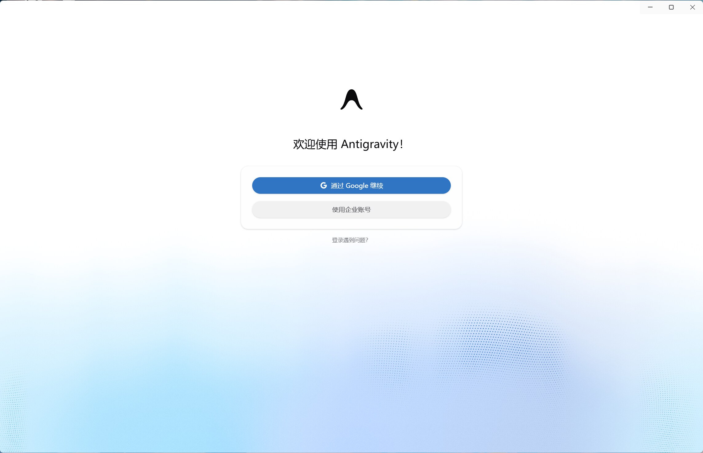
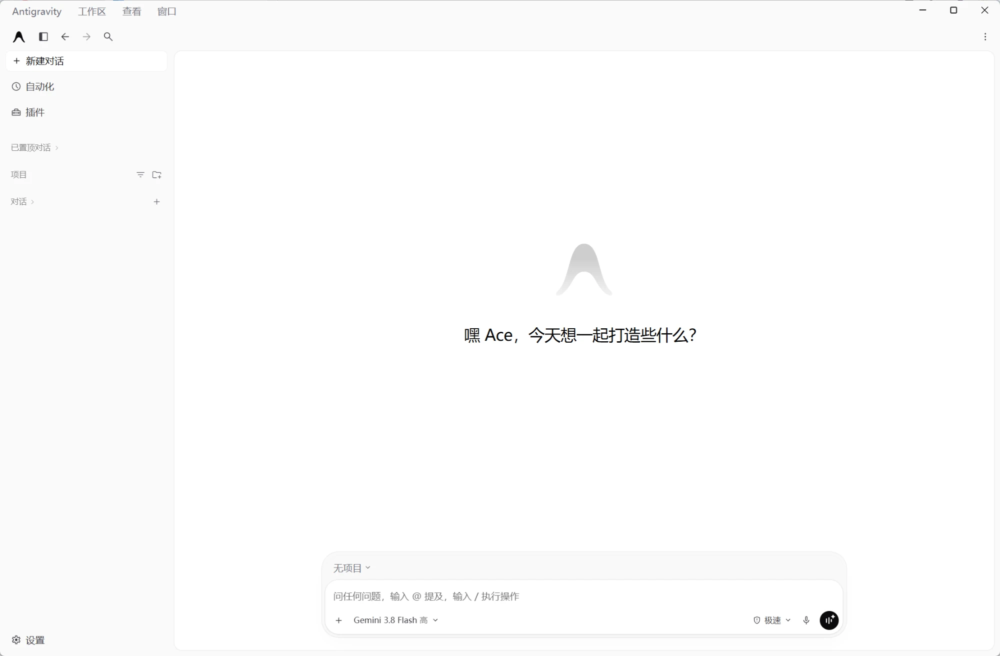
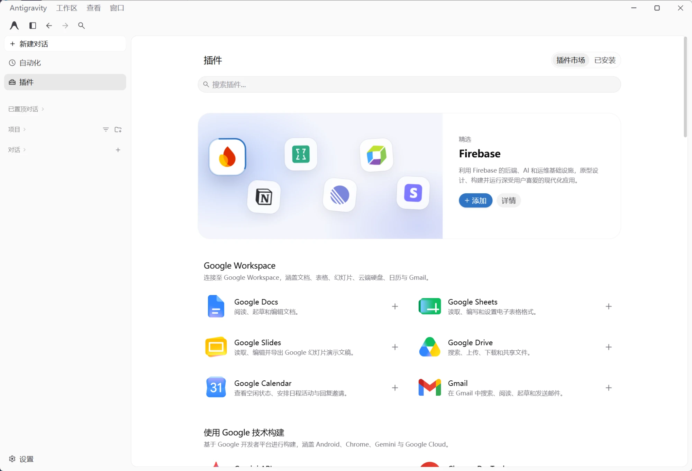

# Antigravity Desktop 汉化包（反重力中文）｜Windows / Mac 简体中文语言包

[](https://github.com/Ace2025001/antigravity-desktop-zhcn/releases/latest)
[](https://github.com/Ace2025001/antigravity-desktop-zhcn/releases)
[](#支持范围)
[](LICENSE)
[](#支持范围)

Google Antigravity（反重力）Desktop 桌面客户端的开源简体中文汉化包（Antigravity 中文语言包）。Windows 和 Apple 芯片 Mac 通用，解压即用，在客户端里点更新后自动跟着重新汉化，随时可以一键卸载汉化、回到官方原版。

[安装教程](https://ace2025001.github.io/antigravity-desktop-zhcn/) · [常见问题](https://ace2025001.github.io/antigravity-desktop-zhcn/faq/) · [更新日志](https://ace2025001.github.io/antigravity-desktop-zhcn/changelog/) · [AI 助手安装指南](docs/ai-install.md) · [English](README.en.md)

### [⬇ 下载完整汉化包（Windows + Mac）](https://github.com/Ace2025001/antigravity-desktop-zhcn/releases/latest/download/Antigravity-Windows%2BMac.zip)

> 下载后请先右键“全部解压缩”，进入 `win启动` 或 `mac启动` 双击 **启动中文**（只需要这一个文件；具体目录与步骤见下方[使用步骤](#使用步骤)）。觉得好用的话，欢迎点右上角 ⭐ **Star** 支持！

## 汉化效果与覆盖范围

| 登录页 | 首页 | 插件市场 |
|---|---|---|
|  |  |  |

**智能体执行过程（完整展示）**


**设置页面全览（完整展示）**


- **基础界面**：主菜单、系统托盘、全局设置、独立对话面板、权限确认弹窗。
- **智能体（Agent）执行过程**：文件创建 / 编辑 / 删除、运行命令与退出代码、MCP 工具调用、图片生成、网页读取、思考中 / 工作中 / 探索中等状态，命令和路径原样保留。
- **插件市场**：官方与合作伙伴的 100+ 插件、子选项、推荐提示词和授权说明。
- **其他细节**：首页问候语、模型用量与配额说明、对话时间线卡片、输入框快捷键提示。
- **保留专有名词**：`agy` CLI、Catppuccin、Dracula、One Dark Pro、Tokyo Night 等不翻译。
- **保持原样**：你输入的内容、对话内容、代码、路径、命令和终端输出。

## 主要特点

- **解压即用**：内置运行环境，无需安装 Node.js；自动找到客户端，找不到时弹窗选择。
- **更新后自动汉化**：在客户端里点“重启以更新”后，自动跟着重新汉化；也可以设为先问你。
- **汉化包自动更新**：启动客户端时按设置自动检查新版本并校验 SHA-256，可自动升级或弹窗提醒。
- **翻译全面**：1.7 万条人工整理的译文，用语统一，告别中英混杂；支持纯英文对话标题自动翻译。
- **新功能也有中文**：Antigravity 更新出了汉化包还没收录的新文字时，可以先用联网补充翻译临时显示中文，等收录了人工译文自动替换。
- **安全可恢复**：对话记录原样保留，一键卸载汉化；Mac 保留官方原版，另建中文副本。

## 使用步骤

1. 下载后右键“全部解压缩”，在解压出来的文件夹里运行。
2. Windows 打开 `win启动`，Mac 打开 `mac启动`。
3. 双击 **启动中文**，按提示完成。第一次运行会问设置，直接回车用推荐值即可。

想换回官方英文原版，双击 **卸载汉化**；想改设置，双击 **汉化设置**。

> 发布页上的文件名是 `Antigravity-完整汉化包-Windows+Mac.zip`，下载后显示为 `Antigravity-Windows+Mac.zip`，是同一个文件。

解压后的目录如下，你只需要用到各自系统文件夹里的三个入口：

```text
antigravity汉化包/
├─ win启动/            ← Windows 用这里
│  ├─ 启动中文.bat      汉化并打开客户端（日常也可以用它打开）
│  ├─ 卸载汉化.bat      还原官方英文原版
│  ├─ 汉化设置.bat      修改下面四项设置
│  └─ 配套程序/         内置运行环境，请保留
├─ mac启动/            ← Mac 用这里（.command 文件，用法相同）
└─ 语言包/             翻译词库和共用程序，请保留
```

## 首次使用的设置

第一次运行“启动中文”时会逐项询问推荐设置，直接回车就是推荐值。以后随时可以在客户端左上角 `Antigravity` 菜单点 **汉化中心**，或者双击目录里的 **汉化设置** 修改。

| 设置 | 选项 | 推荐 |
|---|---|---|
| 客户端更新后怎么处理（Windows） | 自动汉化 / 先问我 / 不处理 | 自动汉化 |
| 汉化包自动更新 | 自动更新 / 先问我 / 关闭 | 自动更新 |
| 界面联网补充翻译（汉化包还没收录的新文字） | 开启 / 关闭 | 开启 |
| 标题自动翻译（Antigravity 生成标题默认为英文） | 开启 / 关闭 | 开启 |

已经装过汉化包的用户，下次运行“启动中文”时会单独问一次“界面联网补充翻译”；回答之前保持关闭。

### 客户端更新后会发生什么

在客户端里点“重启以更新”后，按你的设置处理：

- **自动汉化**：等新版本装好，自动关掉重启出来的英文窗口，重新汉化并打开中文版，过程中有进度窗口，大约 40 秒。
- **先问我**：弹窗问你“是否现在一键汉化”。选“是”打开汉化窗口；选“否”则这个版本不再提醒。
- **不处理**：保持英文，需要时双击“启动中文”。

汉化包只在客户端启动或退出时检查一次。Mac 中文版用桌面上的“Antigravity自动汉化”打开，同样会按设置检查汉化包是否有新版本。

### 汉化包自动更新、界面联网补充翻译与标题自动翻译

- **汉化包自动更新**：无论从桌面图标、任务栏 / 程序坞还是 `启动中文` 打开 Antigravity，都会按设置检查仓库最新版本并校验 SHA-256。选 **自动更新（推荐）** 会在后台下载并校验新版：Windows 上界面译文当场更新（在客户端按 Ctrl+R 刷新后即可看到），其余部分在下次关闭客户端时自动补齐；Mac 上如果中文版正开着，退出后用“Antigravity自动汉化”重新打开一次即可生效。选 **先问我** 会弹窗询问是否更新（点“稍后再说”24 小时内不再提醒）；选 **关闭** 则保持当前版本。可在客户端左上角 `Antigravity` 菜单或目录中的 **汉化设置** 查看当前汉化包版本、已适配最高客户端版本并随时手动检查更新与切换更新策略。检查更新只读取 GitHub 发布页。
- **界面联网补充翻译**：界面优先使用 1.7 万多条人工校对译文。Antigravity 更新后出现汉化包还没收录的按钮、菜单、提示文字时，开启这项会通过谷歌翻译临时显示成中文，结果只存在你的电脑上；汉化包收录人工译文后会自动换成人工译文。只发送这些界面文字；对话内容、代码、终端输出、文件名、链接、路径、账号信息、你自己的技能和规则说明以及你输入的内容都留在本机。关闭后未收录的文字显示英文原文。
- **标题自动翻译**：仅在 Antigravity 自动生成纯英文对话标题时译为中文，只在界面上显示中文，对话记录保持原样；亲手重命名的对话会一直保留你起的标题。
- 以上设置都可以在客户端左上角 `Antigravity` 菜单里的 **汉化中心** 卡片或目录中的 **汉化设置** 入口随时调整，改完按 Ctrl+R（Mac 按 Cmd+R）刷新客户端窗口或重新打开客户端即可生效。

## 支持范围

| 项目 | 说明 |
|---|---|
| Windows x64 | 已在 Antigravity Desktop 2.32.2、2.33.0、2.34.0、2.35.1 实测，支持更新后自动汉化 |
| Apple 芯片 Mac | 保留官方原版，另建一份本地签名的中文副本；Intel Mac 未验证 |
| 适用对象 | Antigravity Desktop 独立桌面客户端 |
| 兼容方式 | 每次汉化前都会检查客户端文件结构；新版本会先尝试自动适配，结构对不上时停下并提示你 |

## 常见问题

### Antigravity 更新后变回英文怎么办？会自动汉化吗？

会自动跟随重新汉化。在客户端里点“重启以更新”后，汉化包会等新版本装好，自动关闭重启出来的英文窗口、重新汉化并打开中文版，整个过程有进度窗口；如果还是英文，再双击一次“启动中文”即可。也可以在“汉化设置”里改成“先问我”或“不处理”。Mac 中文版用桌面上的“Antigravity自动汉化”打开即可。

### 联网翻译会上传我的对话吗？

对话留在本机。界面优先使用本地人工词库，联网只用来补两类文字：开启“界面联网补充翻译”时，发送汉化包还没收录的界面文字（按钮、菜单、提示）；开启“标题自动翻译”时，发送 Antigravity 自动生成的纯英文对话标题。你的对话内容、代码、终端输出、文件名、链接、路径、账号信息、你自己的技能和规则说明以及你输入的内容都留在本机（亲手重命名的标题保持你起的名字）。两项都可以在“汉化设置”里单独关闭，关闭后对应功能停止联网。“汉化包自动更新”只读取 GitHub 发布页上的版本信息并下载安装包，也可以在“汉化设置”里关闭。

### 能恢复官方原版吗？

能。保存工作后双击“卸载汉化”，客户端会还原成官方英文原版，对话记录完整保留。想再用中文时双击“启动中文”即可。

### 下载完整包、语言更新包还是 Source code？

第一次使用只下载完整包。语言更新包只给已经装过完整包的用户更新词条用；Source code 是给开发者用的源码。

### 支持哪些系统版本？

支持 Windows x64（已在 Google Antigravity Desktop 2.32.2、2.33.0、2.34.0、2.35.1 实测）和 Apple 芯片 Mac（保留官方原版并生成本地中文版），Intel Mac 未验证。只适用于反重力（Antigravity Desktop）独立桌面客户端。

### 怎么更新语言包？

默认会自动更新：“汉化包自动更新”设为“自动更新”或“先问我”时，打开或退出客户端都会检查新版本，校验后自动替换，全程自动完成。

关闭了自动更新、或想手动更新时，在[最新发布页](https://github.com/Ace2025001/antigravity-desktop-zhcn/releases/latest)下载完整包，解压后覆盖原来的汉化包文件夹（位置不要变），再双击“启动中文”。

### 汉化时客户端正在运行怎么办？

窗口会提示你保存并退出：按 1 立即关闭，按 2 等你手动退出，60 秒不操作会自动关闭。

### 能让 AI 助手帮我安装吗？

可以。把下面这句话发给豆包、DeepSeek、WorkBuddy、Antigravity、Codex、Claude Code 等 AI 助手：

> 帮我把 https://github.com/Ace2025001/antigravity-desktop-zhcn 安装到电脑上，按仓库里的 docs/ai-install.md 操作

更多问题见[常见问题页](https://ace2025001.github.io/antigravity-desktop-zhcn/faq/)。觉得好用的话，欢迎点右上角 ⭐ Star，让更多人搜到这个汉化包。

## 开发

需要 Node.js >= 22.12.0，执行 `npm ci --ignore-scripts`、`npm test`、`npm run validate`。参见 [系统架构](docs/architecture.md)、[构建与发布](docs/releasing.md)、[Mac 高级说明](macOS/README.md)、[AGENTS.md](AGENTS.md)、[贡献指南](CONTRIBUTING.md)。漏翻词条欢迎到 [Issue](https://github.com/Ace2025001/antigravity-desktop-zhcn/issues) 反馈。

采用 [MIT License](LICENSE) 开源。
