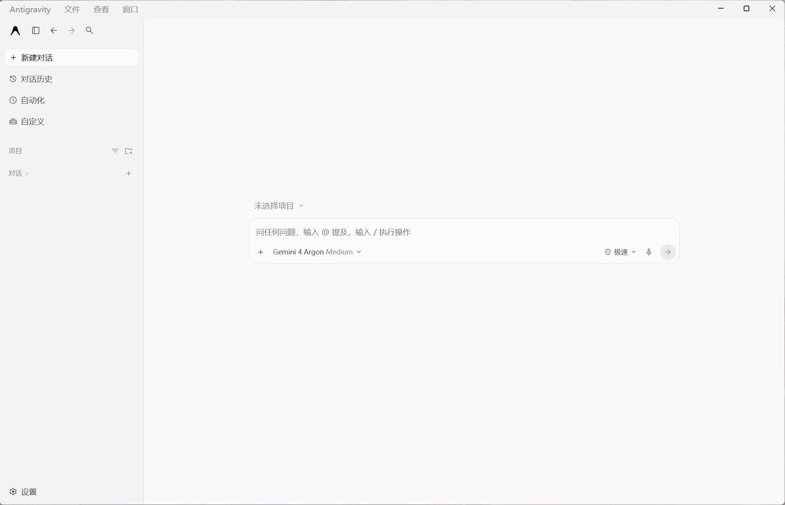

# Antigravity Desktop 汉化包（反重力中文）｜Windows / Mac 简体中文语言包

[](https://github.com/Ace2025001/antigravity-desktop-zhcn/releases/latest)
[](https://github.com/Ace2025001/antigravity-desktop-zhcn/releases)
[](#支持范围)
[](LICENSE)

为 Google Antigravity（反重力）Desktop 独立桌面客户端提供简体中文汉化。Windows x64 与 Apple 芯片 Mac 共用一份语言包，内置运行环境、解压即用，支持自动识别安装位置、客户端更新后自动重新汉化、可选的联网补充翻译和一键恢复英文。已在 Antigravity Desktop 2.32.2（Windows）上实测。不适用于 Antigravity IDE 扩展。

[下载与安装教程](https://ace2025001.github.io/antigravity-desktop-zhcn/) · [Windows 汉化教程](https://ace2025001.github.io/antigravity-desktop-zhcn/windows/) · [Mac 汉化教程](https://ace2025001.github.io/antigravity-desktop-zhcn/macos/) · [常见问题](https://ace2025001.github.io/antigravity-desktop-zhcn/faq/) · [更新日志](https://ace2025001.github.io/antigravity-desktop-zhcn/changelog/) · [AI 助手安装指南](docs/ai-install.md) · [English](README.en.md)

> 觉得好用的话，欢迎点右上角 ⭐ Star 支持一下，能让更多人搜到这个汉化包。

## 下载与使用

### [⬇ 下载完整汉化包（Windows + Mac）](https://github.com/Ace2025001/antigravity-desktop-zhcn/releases/latest/download/Antigravity-Windows%2BMac.zip)

**普通用户只下载 `Antigravity-完整汉化包-Windows+Mac.zip`。** 下载后文件名会显示为 `Antigravity-Windows+Mac.zip`，两者是同一个完整包。不用下载绿色 Code 或 Source code。

下载后右键“全部解压缩”，再打开对应系统的文件夹，双击“启动中文”。不要直接在压缩包里面运行。解压后目录如下：

```text
antigravity汉化包/
├─ win启动/
│  ├─ 启动中文.bat
│  ├─ 恢复英文.bat
│  ├─ 汉化设置.bat
│  └─ 配套程序/
├─ mac启动/
│  ├─ 启动中文.command
│  ├─ 恢复英文.command
│  ├─ 汉化设置.command
│  └─ 配套程序/
└─ 语言包/
   ├─ dom-translations.json
   ├─ macos-translations.json
   ├─ 核心程序/
   └─ 使用说明.txt
```

**Windows 打开 win启动，Mac 打开 mac启动，然后双击“启动中文”。**

- 首次使用：先回答几个设置问题（直接回车即用推荐值），再按中文提示完成安装并启动。
- 已经安装：检查通过后直接启动。
- 语言包或客户端更新：检测变化后重新应用中文，再启动。
- 恢复英文：保存工作并退出应用，再双击“恢复英文”。

共用代码位于“语言包/核心程序”，Windows、Mac 各自的运行环境位于对应启动目录的“配套程序”，不要删除。正式包内置运行环境，无需安装 Node.js。Mac 首次安装需要按提示等待原版首页显示、保存工作并按 ⌘Q 退出，不会强制关闭任务。

## 首次使用的设置

第一次运行“启动中文”时，会在窗口里问几个问题，直接回车即使用推荐值。之后随时可以双击启动目录里的 **汉化设置** 修改。

| 设置 | 选项 | 推荐 |
|---|---|---|
| 客户端更新后怎么处理（Windows） | 自动汉化 / 先问我 / 不处理 | 自动汉化 |
| 联网补充翻译 | 开启 / 关闭 | 开启 |

**客户端更新后自动汉化（Windows）**：选“自动汉化”或“先问我”时，会在当前用户下添加一个名为 `AntigravityZhcnAutoFollow` 的计划任务，开机时和每 30 分钟做一次很轻的检查（只比较客户端文件大小和时间）。发现客户端更新后：

- **自动汉化**：客户端没开时在后台直接汉化；正在使用时不打扰你，等你关闭客户端后再汉化；在客户端里点“重启以更新”时，会在新版本启动后自动接管并汉化。后台汉化绝不会强制关闭你正在用的客户端。
- **先问我**：弹窗询问“已检测到客户端更新，是否一键汉化？”。选“否”后这个版本不再提醒。

选“不处理”时不添加计划任务。**恢复英文或完全卸载时，计划任务会被一并删除。**

**联网补充翻译**：汉化包收录了 1.6 万多条人工整理的译文。开启后，遇到还没收录的新英文时，会联网用谷歌翻译补齐，结果保存在本机供下次使用。只会发送界面上的文字和对话标题；**对话内容、代码、终端输出、文件和你输入的内容都不会发送**。关闭后完全不联网，也不再使用之前联网翻译的结果。改完重新打开客户端即可生效，不需要重新汉化。

**对话标题**：新版客户端会用英文生成对话标题。汉化包只在界面上显示中文标题，**不会修改你的对话记录**，恢复英文后标题自动变回原样。

## 关于“Antigravity自动汉化”快捷方式

Windows 已改由后台自动汉化处理客户端更新，不再创建这个快捷方式，之前由汉化包创建的会被自动移除；平时直接用官方的 Antigravity 图标打开即可。Mac 暂时没有后台自动汉化，仍会在桌面和 mac启动 文件夹创建 **Antigravity自动汉化**，用它打开时会先检查并在需要时重新汉化。

找不到客户端时会弹窗选择；已记住的位置有效时直接使用。需要修改文件而客户端仍在运行时，会提示保存并退出：60 秒内手动退出会被自动识别并继续；按 1 立即强制关闭，按 2 不强制、一直等你手动退出；60 秒无操作时先请求正常退出，仍未退出则强制关闭。开启了 Antigravity“后台运行”时，关闭窗口不会退出程序，请从托盘图标选择 Quit。汉化工具自己临时打开的客户端会直接关闭。工具不能可靠判断是否有任务正在执行，因此不会将低 CPU 占用视为空闲。

## 持续更新语言包

本项目会持续更新翻译内容、补充遗漏词条并改进中文表达。如果你发现本地汉化覆盖较低、仍有较多英文，或客户端更新后出现未翻译内容，可以随时回到本项目，在[最新发布页](https://github.com/Ace2025001/antigravity-desktop-zhcn/releases/latest)下载最新语言包。

已有完整包的用户，将下载内容中的“语言包”文件夹替换到原目录，再次运行“启动中文”即可应用更新。首次使用请下载完整汉化包。

## 支持范围

- 适用于 Antigravity Desktop 独立桌面客户端，不是 Antigravity IDE 扩展语言包。
- Windows x64：原有备份、恢复与动态适配流程。
- macOS Apple 芯片：保留官方原版，创建独立中文应用副本，使用本地签名。
- Mac 补充包实测 macOS 27.0.1 / Desktop 2.29.0 / arm64。合并后的完整流程仍待真实客户端实机复验；Intel Mac 未验证。
- Windows 已在 Antigravity Desktop 2.32.2 上实测。
- 两端均须通过结构和资源检查；不承诺兼容所有新旧版本。不修改代理、节点或 TUN。



## 常见问题


### 下载完整包、语言更新包还是 Source code？

首次使用只下载完整包。语言更新包只适用于已有新版完整包的用户；Source code 和绿色 Code 按钮提供开发源码，不是直接使用的离线包。


### 客户端更新后会自动汉化吗？

Windows 上首次运行选了“自动汉化”（推荐）就会：后台定时检查，发现更新后自动重新汉化，详见上方“首次使用的设置”。选“先问我”会弹窗询问。另外，通过“Antigravity自动汉化”或“启动中文”打开时也会检查并重新应用。自动汉化不会自动下载新语言包，也不保证未来每个客户端版本均兼容。

### 会联网吗？会不会发送我的对话？

只有开启“联网补充翻译”时才会联网，且只发送界面上还没收录的英文和对话标题，对话内容、代码、终端输出、文件和你输入的内容都不会发送。关闭后完全不联网。可以随时在“汉化设置”里开关。

### 能恢复英文吗？

可以。保存工作后运行对应系统目录中的“恢复英文”，确认成功后再清理汉化工具和备份。详细步骤见上方 Windows 与 Mac 教程。

### 本汉化包具体覆盖了哪些内容？有哪些深度汉化特色？

不仅完整覆盖了应用的基础主菜单、系统托盘、全局设置与项目外独立对话面板，还进行了全方位的深度汉化与变量覆盖，告别生硬机翻与中英混杂：

- **智能体执行过程与工具调用（Agent Tool Calling）流式深度本地化**：深度覆盖智能体运行全生命周期——
  - **文件系统操作**：文件创建（`Created` → `已创建`）、文件编辑（`Edited` → `已编辑`）、文件删除（`Deleted` → `已删除`）、行号范围查看（`Viewed path:1-50` → `已查看 path:1-50`）；
  - **Shell 命令行执行**：命令实时执行（`Running command` → `正在运行命令`）、完成与参数摘要（`Ran command: ...` → `已运行命令：...`）、异常退出代码精准呈现（`exit code 1` → `退出代码 1`）；
  - **多模态与外部生态**：MCP 外部工具调用（`Used MCP tool: server/tool` → `已使用 MCP 工具：server/tool`）、多模态图片生成（`Generated image: "prompt"` → `已生成图片：“prompt”`）；
  - **状态机与思考流**：网页检索与大纲提取（`Reading page` / `Created outline` → `正在读取页面` / `已创建大纲`）、思考中/工作中/探索中（`Thinking` / `Working` / `Exploring` → `思考中` / `工作中` / `探索中`），动态运行耗时（`Running for 5m` → `已运行 5m`），所有动态参数、命令与路径变量无缝融合，提供工业级沉浸式纯中文交互；
- **插件市场与生态全方位覆盖**：完整汉化官方（Official）与合作伙伴（Partners）全部 75+ 插件及其所有子级选项、推荐提示词（Suggested Prompts）、设置说明与第三方服务授权协议；
- **全动态问候与配额说明**：首页动态问候语变体根据用户名称无缝本地化，模型用量弹窗与免费/订阅用户配额说明 100% 纯正中文覆盖；
- **对话导航与历史轮次卡片**：全量覆盖会话时间线导航卡片、轮次（Turn 1、Turns 1–5）、图片/音视频媒体附件统计以及悬浮卡片预览；
- **发送控制与快捷键提示**：完整汉化输入框快捷键悬浮提示（`发送消息 Enter`、`排队消息 (Alt+Enter)`、`取消 (Ctrl+D)` 与录音控制）；
- **规范保留专有名词**：遵循主流开发工具习惯，规范保留经典代码主题（Catppuccin、Dracula、One Dark Pro、Tokyo Night 等）与命令行可执行标识符（如 `agy` CLI），杜绝怪异机翻。

### 能让 AI 助手帮我安装吗？

可以。把本仓库地址发给 豆包、deepseek、反重力（antigravity）、Codex 、Claude Code 等 AI 助手，让它按 [AI 助手安装指南](docs/ai-install.md) 操作即可。指南写明了下载地址、SHA-256 校验、各平台命令、结果判断和恢复方法。AI 助手也会读取仓库根目录的 [AGENTS.md](AGENTS.md)。
### 一键粘贴指令：
### 帮我把https://github.com/Ace2025001/antigravity-desktop-zhcn安装在电脑内，按 [AI 助手安装指南](docs/ai-install.md) 操作

## 开发与高级说明

此仓库是源码目录，日常使用请下载正式包。源码需要 Node.js >= 22.12.0，执行 `npm ci --ignore-scripts`、`npm test` 和 `npm run validate`。

- [AI 助手安装指南](docs/ai-install.md) · [AGENTS.md](AGENTS.md)
- [Mac 高级说明](macOS/README.md)
- [构建与发布](docs/releasing.md)
- [系统架构](docs/architecture.md)
- [问题反馈](https://github.com/Ace2025001/antigravity-desktop-zhcn/issues)

## 致谢

感谢以下朋友对本项目的贡献：

- [@javaht](https://github.com/javaht)：macOS 平台适配与实机测试，跨平台路径修复（[#7](https://github.com/Ace2025001/antigravity-desktop-zhcn/pull/7)）。

欢迎通过 [Issue](https://github.com/Ace2025001/antigravity-desktop-zhcn/issues) 反馈漏翻词条，或提交合并请求参与改进，详见 [贡献指南](CONTRIBUTING.md)。

采用 [MIT License](LICENSE) 开源。
