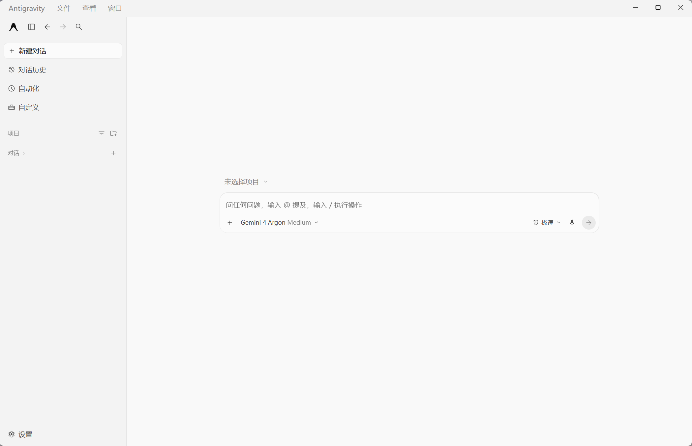

# Antigravity Desktop 汉化包｜Windows / Mac 简体中文语言包

为 Google Antigravity Desktop 独立桌面客户端提供社区维护的简体中文汉化。Windows x64 与 Apple 芯片 Mac 共用一份语言包，完整包可离线运行，支持自动识别安装位置、自动汉化快捷方式和恢复英文。非官方项目，不适用于 Antigravity IDE 扩展。

[下载与安装教程](https://ace2025001.github.io/antigravity-desktop-zhcn/) · [Windows 汉化教程](https://ace2025001.github.io/antigravity-desktop-zhcn/windows/) · [Mac 汉化教程](https://ace2025001.github.io/antigravity-desktop-zhcn/macos/) · [English](README.en.md)

## 下载与使用

### [⬇ 下载完整汉化包（Windows + Mac）](https://github.com/Ace2025001/antigravity-desktop-zhcn/releases/latest/download/Antigravity-Windows%2BMac.zip)

**普通用户只下载 `Antigravity-完整汉化包-Windows+Mac.zip`。** 不用下载绿色 Code 或 Source code。

下载后右键“全部解压缩”，再打开对应系统的文件夹，双击“启动中文”。不要直接在压缩包里面运行。解压后目录如下：

```text
antigravity汉化包/
├─ win启动/
│  ├─ 启动中文.bat
│  ├─ 恢复英文.bat
│  └─ 配套程序/
├─ mac启动/
│  ├─ 启动中文.command
│  ├─ 恢复英文.command
│  └─ 配套程序/
└─ 语言包/
   ├─ dom-translations.json
   ├─ macos-translations.json
   ├─ 核心程序/
   └─ 使用说明.txt
```

**Windows 打开 win启动，Mac 打开 mac启动，然后双击“启动中文”。**

- 首次使用：按中文提示完成安装并启动。
- 已经安装：检查通过后直接启动。
- 语言包或客户端更新：检测变化后重新应用中文，再启动。
- 恢复英文：保存工作并退出应用，再双击“恢复英文”。

共用代码位于“语言包/核心程序”，Windows、Mac 各自的运行环境位于对应启动目录的“配套程序”，不要删除。正式包内置运行环境，无需安装 Node.js。Mac 首次安装需要按提示等待原版首页显示、保存工作并按 ⌘Q 退出，不会强制关闭任务。

## 自动汉化快捷方式

成功启动后，会在桌面和对应启动目录创建 **Antigravity自动汉化**。不存在才创建，路径变化才更新；正常运行不会反复保存快捷方式，也不会覆盖用户同名文件。以后可直接双击它，继续执行相同的汉化检查和启动流程。

找不到客户端时会弹窗选择；已记住的位置有效时直接使用。需要修改文件而客户端仍在运行时，提示保存并退出，逐秒倒计时 60 秒后请求正常退出；被未保存提示阻止时停止，不强杀。工具不能可靠判断是否有任务正在执行，因此不会将低 CPU 占用视为空闲。

## 从旧版升级

**v2.2.0 及更早版本，请先下载完整包并解压到新目录。** 本版重整了目录和启动入口，不要只用语言包覆盖旧版。成功运行新版“启动中文”后，桌面自动汉化快捷方式会更新。保留系统中的原始备份和安装状态。

## 以后如何更新翻译？

已有完整包时，下载 **仅更新语言包-不能单独使用.zip**，将其中的“语言包”替换到原目录，然后再次运行“启动中文”。首次使用请下载上面的完整包。Windows 与 Mac 读取同一份词库，不必分别更新。

只有客户端底层结构、签名要求或执行器逻辑发生变化时，才需要下载完整包。更新词库不等于兼容所有新旧客户端版本。

## 支持范围

- 适用于 Antigravity Desktop 独立桌面客户端，不是 Antigravity IDE 扩展语言包。
- Windows x64：原有备份、恢复与动态适配流程。
- macOS Apple 芯片：保留官方原版，创建独立中文应用副本，使用本地签名。
- Mac 补充包作者记录实测 macOS 27.0.1 / Desktop 2.29.0 / arm64。合并后的完整流程仍待真实客户端实机复验；Intel Mac 未验证。
- 两端均须通过结构和资源检查；不承诺兼容所有新旧版本。不修改代理、节点或 TUN。



## 常见问题

### Antigravity 中文版与这个汉化包是什么关系？

这是给已安装的 Antigravity Desktop 添加简体中文界面的第三方工具，不是官方中文版，也不包含客户端安装程序。请先确认英文原版能正常使用。

### 下载完整包、语言更新包还是 Source code？

首次使用只下载完整包。语言更新包只适用于已有新版完整包的用户；Source code 和绿色 Code 按钮提供开发源码，不是直接使用的离线包。

### 为什么压缩包显示空文件夹？

v2.3.0 的 ZIP 中文文件名编码存在 Windows 资源管理器兼容问题，已在 v2.3.1 修复。请下载最新完整包并“全部解压缩”。

### 客户端更新后会自动汉化吗？

通过“Antigravity自动汉化”或“启动中文”打开时，会检查汉化是否有效，必要时尝试重新应用。这个快捷方式不会自动下载新语言包，也不保证未来每个客户端版本均兼容。

### 能恢复英文吗？

可以。保存工作后运行对应系统目录中的“恢复英文”，确认成功后再清理汉化工具和备份。详细步骤见上方 Windows 与 Mac 教程。

## 开发与高级说明

此仓库是源码目录，日常使用请下载正式包。源码需要 Node.js >= 22.12.0，执行 `npm ci --ignore-scripts`、`npm test` 和 `npm run validate`。

- [Mac 高级说明](macOS/README.md)
- [构建与发布](docs/releasing.md)
- [系统架构](docs/architecture.md)
- [问题反馈](https://github.com/Ace2025001/antigravity-desktop-zhcn/issues)

基于 [chenmo00000/antigravity-desktop-zhcn](https://github.com/chenmo00000/antigravity-desktop-zhcn) 维护扩展，采用 [MIT License](LICENSE)，与 Google 无隶属关系。
